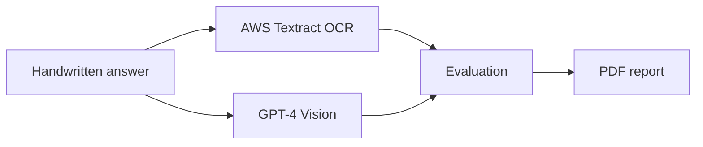
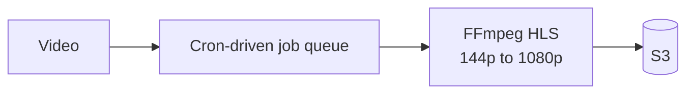
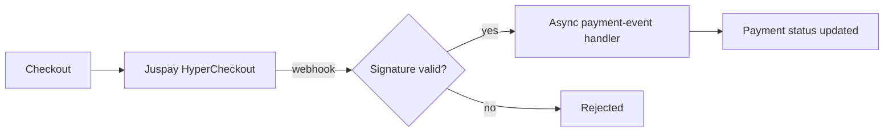
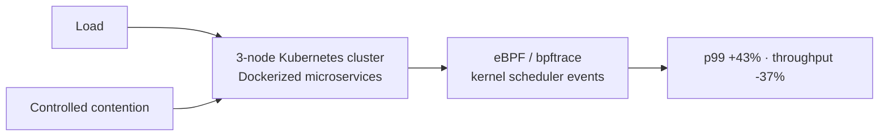
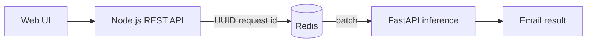

<p align="center">
  
</p>

<p align="center">
  <a href="https://www.linkedin.com/in/rajatsrivastava24/"></a>
  <a href="mailto:rajatk24srivastava@gmail.com"></a>
  <a href="https://srvstvrajat.github.io/Portfolio/"></a>
  <a href="https://codeforces.com/profile/rajat_srvstv"></a>
  <a href="https://leetcode.com/u/SrvstvRajat"></a>
  
</p>

```console
$ whoami
rajat — backend engineer · M.Tech CSE @ IIIT-Delhi (graduating 2027)

$ cat now.txt
studying   graduate systems, algorithms, big data analytics
exploring  tail latency in Kubernetes with eBPF
open to    backend / systems engineering roles and good collabs
```

<br/>

### The trace

Every bar is a span. The three projects sit under the M.Tech span because that is where they happened, and the last two ran side by side.

<p align="center">
  
</p>

<br/>

### What moved

<p align="center">
  
</p>

<br/>

### Work worth opening

Each one expands into the shape of the system.

<details>
<summary><b>Prepp API performance</b> &nbsp;·&nbsp; CollegeDunia &nbsp;·&nbsp; <code>NestJS</code> <code>GraphQL</code> <code>MongoDB</code> <code>Redis</code></summary>
<br/>

Cut API latency by **35%** by caching hot reads in Redis, tuning MongoDB indexes and restructuring queries across the NestJS/GraphQL services.

</details>

<details>
<summary><b>AI evaluation of handwritten UPSC answers</b> &nbsp;·&nbsp; <code>GPT-4 Vision</code> <code>AWS Textract</code></summary>
<br/>

Cost per evaluation went from about ₹50 to about ₹2 (**96% less**), and the team relies less on human evaluators.



</details>

<details>
<summary><b>In-house HLS video pipeline</b> &nbsp;·&nbsp; <code>FFmpeg</code> <code>AWS S3</code></summary>
<br/>

Replaced AWS MediaConvert, removing per-minute conversion charges. Processes 7–8 videos a day.



</details>

<details>
<summary><b>Payments on Juspay HyperCheckout</b> &nbsp;·&nbsp; <code>REST</code> <code>Webhooks</code></summary>
<br/>

Moved the backend payment workflow to Juspay HyperCheckout. Webhook signatures are validated, and payment events are handled asynchronously so status updates can be trusted.



</details>

<details>
<summary><b>Tail latency in Kubernetes with eBPF</b> &nbsp;·&nbsp; Feb–May 2026 &nbsp;·&nbsp; <code>Kubernetes</code> <code>Docker</code> <code>bpftrace</code></summary>
<br/>

A 3-node cluster running Dockerized microservices, with controlled resource contention applied to benchmark tail latency. Kernel events traced with eBPF/bpftrace pointed to **scheduler-level contention** as the cause of **43% higher p99 latency** and **37% lower throughput**.



</details>

<details>
<summary><b>FoodEVPred, async ML inference</b> &nbsp;·&nbsp; Jan–Apr 2026 &nbsp;·&nbsp; <code>Node.js</code> <code>FastAPI</code> <code>Redis</code></summary>
<br/>

Classifies food-derived EV protein sources. A Node.js REST backend fronts a Python/FastAPI inference service; requests are tracked by UUID, batched through Redis, and results are emailed automatically.



</details>

<details>
<summary><b>Cellular network capacity simulator</b> &nbsp;·&nbsp; Aug–Dec 2025 &nbsp;·&nbsp; <code>C++</code> <code>Multithreading</code></summary>
<br/>

Object-oriented C++ simulator with users, resource allocation and capacity constraints as separate components. Allocation is multithreaded and keeps shared state consistent under concurrent user operations.

</details>

<br/>

### Toolbox

<p align="center">
  <br/>
  
</p>

<br/>

### Scoreboard

| | |
|---|---|
| **Codeforces** | Expert, max rating 1608 |
| **LeetCode** | rating 1809, 2000+ problems solved across platforms |
| **GATE CSE 2024** | All India Rank 2543 |
| **Google Hash Code 2021** | rank 414 |
| **Google Kick Start 2021** | global rank 1789 |
| **IIIT-Delhi M.Tech** | CGPA 8.63 · 2025–2027 |
| **MMMUT B.Tech** | CGPA 7.58 · 2019–2023 |

<p align="center">
  
</p>

<br/>

### Contribution graph, eaten

<p align="center">
  <picture>
    <source media="(prefers-color-scheme: dark)" srcset="https://raw.githubusercontent.com/SrvstvRajat/SrvstvRajat/output/github-snake-dark.svg" />
    <source media="(prefers-color-scheme: light)" srcset="https://raw.githubusercontent.com/SrvstvRajat/SrvstvRajat/output/github-snake.svg" />
    
  </picture>
</p>

<p align="center">
  
  
</p>

<br/>

<p align="center">
  <i>If you want to talk backend systems, performance, or algorithms, say hi.</i><br/>
  <a href="https://www.linkedin.com/in/rajatsrivastava24/">LinkedIn</a> &nbsp;·&nbsp; <a href="mailto:rajatk24srivastava@gmail.com">Email</a> &nbsp;·&nbsp; <a href="https://www.instagram.com/rajat._srivastava">Instagram</a>
</p>
